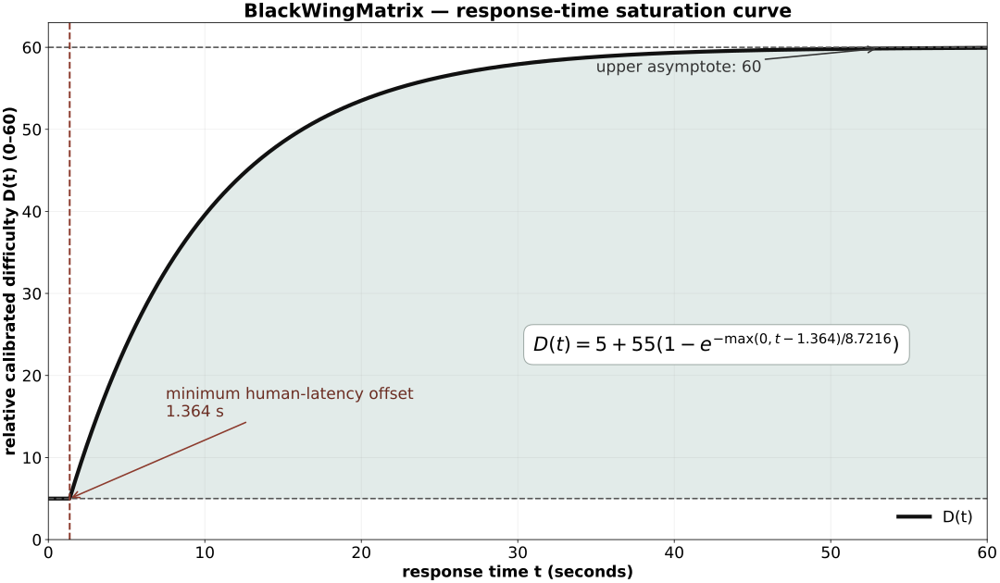

# Time-based difficulty calibration

This document specifies the relative, response-time-only calibration currently used by BlackWingMatrix. It is an implementation model for aligning the internal 0–60 exercise scale with the supplied test reports. It is **not** an IRT calibration, a norming study, or an IQ conversion.



The same figure is available as a lossless 3600×2100 PNG: [time-calibration-curve.png](time-calibration-curve.png). It is generated by [generate_time_calibration_plot.py](generate_time_calibration_plot.py).

## Inputs and scope

For each included exported observation `i`, the model keeps only:

- the family `f_i`;
- the requested/observed item score `s_i` on the internal 0–60 scale;
- the response duration `t_i`, in seconds.

Correctness, the selected answer and answer distance are intentionally excluded from this *family recalibration*. They still belong to the adaptive test's real-time ability update. This separation prevents a participant's momentary answer choices from directly relabelling a generator's structural difficulty.

## 1. Relative difficulty implied by response time

For a duration `t`, first calculate the bounded saturation mapping:

$$
D(t)=\operatorname{clamp}_{[5,60]}\left[5+55\left(1-\exp\left(-\frac{\max(0,t-1.364)}{8.7216}\right)\right)\right].
$$

Parameters:

| Parameter | Value | Role |
|---|---:|---|
| lower scale bound | 5 | prevents time-only evidence from creating a subscale below the usable difficulty range |
| upper asymptote | 60 | preserves high-difficulty saturation instead of allowing unbounded scores |
| latency offset | 1.364 s | removes implausibly instantaneous response time before the curve starts increasing |
| time constant | 8.7216 s | controls the rate at which additional time yields less additional relative difficulty |

The negative exponential is monotone but concave: extra time near the beginning matters more than the same number of seconds near the ceiling. This is the desired behaviour for a bounded relative difficulty scale, not a claim that human ability itself follows this exact function.

## 2. Family residuals and smooth level-dependent correction

For each observation in a family, calculate the time residual:

$$
r_i=D(t_i)-s_i,
\qquad x_i=\frac{\operatorname{clamp}(s_i,5,60)-5}{55}.
$$

At a raw requested score `s`, let `x=(clamp(s,5,60)-5)/55` and use Gaussian local weights with bandwidth `b=9`:

$$
w_i(s)=\exp\left[-\frac12\left(\frac{s-s_i}{9}\right)^2\right],
\quad h=\sum_i w_i,
\quad L(s)=\frac{\sum_i w_i r_i}{\max(h,10^{-4})}.
$$

`L(s)` is blended with a regularised linear trend across the family:

$$
C(s)=\bar r+\frac{\operatorname{Cov}(x_i,r_i)}{\operatorname{Var}(x_i)+0.08}(x-\bar x).
$$

Its reliability terms are

$$
\rho_L=1-\exp(-h/1.6),
\qquad \rho_C=\frac{n}{n+4}.
$$

The bounded raw adjustment and final family adjustment are:

$$
A_0(s)=\operatorname{clamp}_{[-10,10]}\left[
\frac{\rho_L L(s)+\rho_C C(s)}{\max(10^{-4},\rho_L+\rho_C)}
\max(\rho_L,\rho_C)
\right],
$$

$$
g(s)=\frac{\operatorname{clamp}(s,5,60)-5}{55},
\qquad A(s)=g(s)A_0(s),
$$

$$
S_{\mathrm{cal}}(f,s)=\operatorname{clamp}_{[5,60]}\bigl(s+A_f(s)\bigr).
$$

The multiplier `g(s)` is important: corrections vanish at the lower bound and rise continuously with requested difficulty. Therefore, evidence that a family is too easy at difficult instances lowers the high part of that family more than its easy instances; there is no hard-coded family position or fixed global offset.

## 3. Using the profile during generation

When an adaptive, progressive, calibration or single-exercise request asks for target difficulty `q`, the generator does not directly generate at `q` for families with time evidence. It finds the raw generator target on a 0.25-point grid:

$$
s^*=\underset{s\in\{5,5.25,\ldots,60\}}{\operatorname{argmin}}
\;\left|S_{\mathrm{cal}}(f,s)-q\right|.
$$

The existing family generator then receives `s*`. This is why a corrected difficulty changes the structural examples generated at every level while retaining the existing seed, family-capability and adaptive-selection infrastructure. Families without time observations use their requested target unchanged.

## Updating calibration from exported reports

Use the repository script to merge one or more exported adaptive-test reports and regenerate the calibration block in both `index.html` and `blackwingmatrix.html`:

```bash
python3 tools/recalibrate_reports.py report-a.csv report-b.json
```

Accepted input is CSV or JSON exported by BlackWingMatrix. The script retains only `family`, `itemScore` (or `targetDifficulty`) and response duration; it excludes ignored-too-fast records and records explicitly excluded from evaluation. Each imported report is tracked by its SHA-256 digest, so rerunning the script with the same file does not double-count it, while equal observations from *different* reports remain valid independent evidence. Observations are deterministically limited to 500 per family so the browser payload cannot grow without bound. It prints and writes `tools/last-recalibration-summary.json` with the included report paths, valid count, retained count, per-family sample sizes and active curve parameters.

Use `--dry-run` to inspect the result without touching files. `--replace-observations` deliberately discards the embedded historical observations, so it is appropriate only when the supplied reports are the complete replacement dataset. By default the global saturation parameters are preserved and only the family profiles are updated. `--reestimate-curve` additionally performs a deterministic robust grid fit of the latency offset and time constant; use it only with a sufficiently broad, representative combined dataset.

## Evidence basis and limitations

The implementation draws on established psychometric treatment of response time and on speed–accuracy trade-off research. It does **not** copy a published scoring equation or claim that the constants above are population parameters. Those constants are fitted from the supplied BlackWingMatrix reports and must be re-estimated as more representative data are collected.

1. van der Linden, W. J. (2007). *A Hierarchical Framework for Modeling Speed and Accuracy on Test Items*. **Psychometrika, 72**, 287–308. https://doi.org/10.1007/s11336-006-1478-z — joint modelling of speed and accuracy, including a response-time model for test items.
2. Heitz, R. P. (2014). *The speed-accuracy tradeoff: history, physiology, methodology, and behavior*. **Frontiers in Neuroscience, 8**, 150. https://doi.org/10.3389/fnins.2014.00150 — reviews speed–accuracy trade-offs and notes exponential approaches to a limit for time-course functions.
3. Dutilh, G. et al. (2011). *A Phase Transition Model for the Speed–Accuracy Trade-Off in Response Time Experiments*. **Cognitive Science, 35**, 211–250. https://doi.org/10.1111/j.1551-6709.2010.01147.x — demonstrates why response time and accuracy must be interpreted together rather than treating either as a direct universal measure of ability.

The current model intentionally uses response time only to compare item families relative to one another in this application. It should be replaced by a preregistered, adequately sampled joint RT/accuracy model before being presented as a validated psychometric scale.
